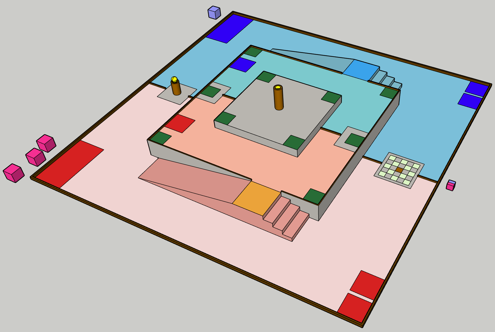
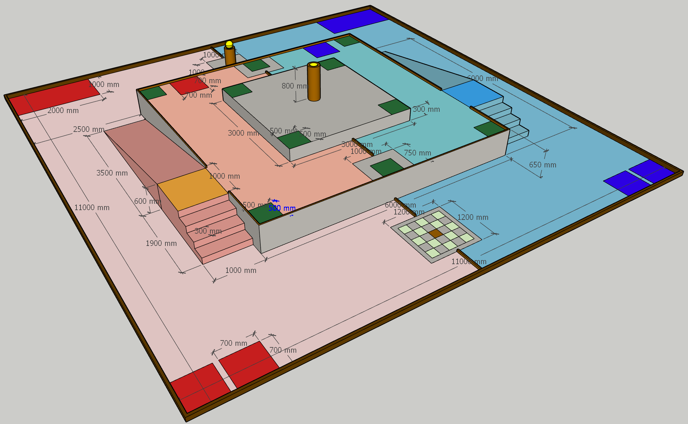
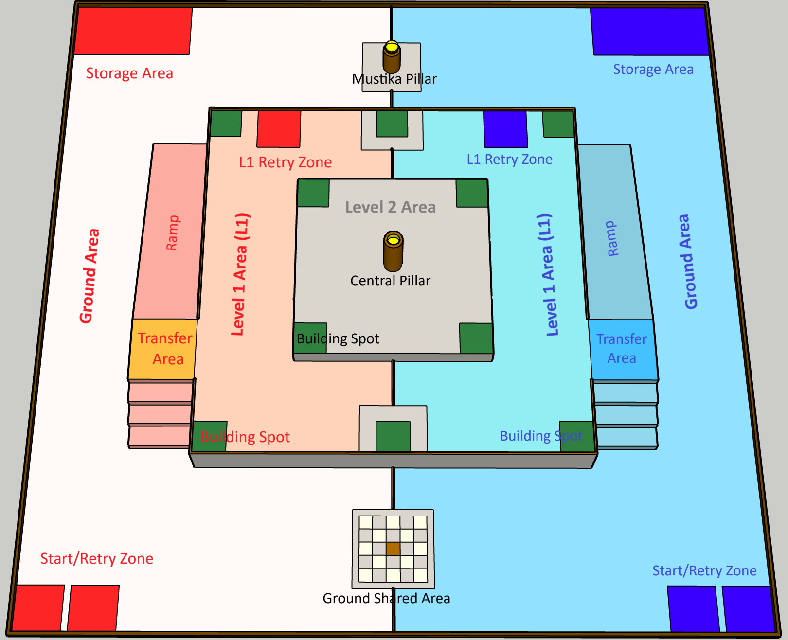
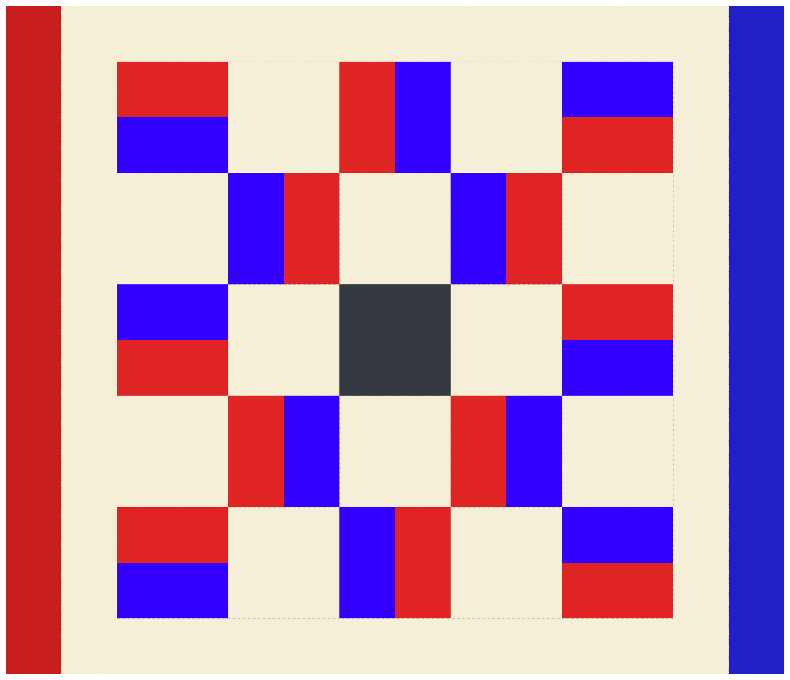

# ABU 2027 亚太大学生机器人大赛（印度尼西亚·梭罗）

## 主题与规则：“追寻努山塔拉五色石”（The Pursuit of Mustika Nusantara）

**版本：** 2026 年 10 月 24日（V1.1 最新版）
**发布机构：** ABU Robocon 2027 梭罗组委会
**官网：** http://www.aburobocon2027.id

> *说明：本规则书为 V1.1 最终生效版。原 V1.0 版本中的相关条款已按此版本更新，不再保留历史修订痕迹。若中文翻译与英文原版存在歧义，以官方英文原版及后续 FAQ 为准。*

---

## 背景与理念

### 穆斯蒂卡·努桑塔拉传说

早在现代科技出现之前，古代富有远见的工程师们便建造了宏大的庙宇群落，以调和自然的原始力量。这些结构远不只是石头纪念碑——它们构成了一张庞大而相互连通的能量网络。在这套建筑的至高处，安放着“穆斯蒂卡”（Mustika，即五色石）——一件熠熠生辉的圣物，它激活并稳定着遍布群岛的宏大努桑塔拉能量网格。数个世纪过去，时光打散了这些完美的基座，古老的网格彻底沉寂。如今，新一代勇敢的机器人队伍被召唤而来，复活这座神圣的石头建筑，找回它失落的能量。

为了完成这一使命，各队必须设计出将原始举升力量与精巧自动化融为一体的机器。**运输机器人（Transporter Robot，TR）** 是敏捷的采集者，在低处地形中穿行，采集沉重的大地块（Earth Block），并将其运送到指定的交接区（Transfer Area）。**建造机器人（Builder Robot，BR）** 则是全自主的“总建筑师”，精确地堆叠这些基座、重建失落的立柱，并在最顶端放上封顶的天空方块（Sky Block），从而接通能量回路。终极考验在争夺最激烈的中央区域展开——相互竞逐的建造者们争先将穆斯蒂卡安放上最高的立柱，重启能量网格。整场比赛被设计为一场三分钟高强度、不间断垂直物流的马拉松。

## 安全的重要性

**安全第一。** 安全是 ABU Robocon 的最高优先事项。各队在设计、制造和参赛等所有阶段都必须把安全放在首位，并与主办方全力合作，为所有相关人员（队员、观众、工作人员及周边环境）营造安全的环境。所有队员在比赛和练习期间必须穿戴主办方指定的安全装备。

## 赛事与日程

所有选拔队伍参加 2027 年印度尼西亚梭罗 ABU Robocon 的国内比赛，均须遵守本规则书中的规则。但如果国内比赛无法获得规定的材料，当地主办方应使用其国家/地区内可获得的最佳替代品。

| 日期                  | 事项         |
| :-------------------- | :----------- |
| 2027年8月27日（周五） | 报到         |
| 2027年8月28日（周六） | 试运行、彩排 |
| 2027年8月29日（周日） | 比赛日       |
| 2027年8月30日（周一） | ABU 全体大会 |
| 2027年8月31日（周二） | 离会         |

**比赛场馆：** Edutorium UMS，印度尼西亚梭罗

---

## 1. 比赛场地与道具

*图1：比赛场地总览。展示场地三维透视图，可见中央二层平台、四周一层平台、坡道、楼梯和地面区。*

*图2：比赛场地尺寸。图中标注了各区域的具体尺寸。*

比赛场地各部件尺寸的详细图纸，见另行发布的附录文件。

---

## 2. 术语与定义

> **术语通则：** “区（Zone）”仅用于机器人所在的位置区（启动/重试区、L1重试区）；“区域（Area）”用于比赛场地的各区域（如红队区域、蓝队区域、运行区域、区域违规）。

| 术语                                      | 定义                                                                                                                                                             |
| :---------------------------------------- | :--------------------------------------------------------------------------------------------------------------------------------------------------------------- |
| **比赛场地 (Game Field)**           | 主比赛场地，尺寸 11000 mm × 11000 mm，划分为两队各自特定的运行区域。                                                                                            |
| **地面区 (Ground Area)**            | 比赛场地中最低的平面，启动/重试区、存储区、地面共享区及穆斯蒂卡柱所在之处，是运输机器人（TR）的主要作业地面。                                                    |
| **启动/重试区 (Start/Retry Zone)**  | 地面区内两个指定的区域，每个尺寸 700 mm × 700 mm。各队可自由选择哪个区供 TR 使用、哪个供 BR 使用。每个区既用于比赛启动，也用于重试。                            |
| **L1 重试区 (L1 Retry Zone)**       | 一层上指定的区域，尺寸 700 mm × 700 mm，位于每队一侧。重试时，BR 可被送回 L1 重试区，从而在高层作业时更快恢复。                                                 |
| **存储区 (Storage Area)**           | 每队地面区内的专属区域，尺寸 1000 mm × 2000 mm。比赛开始时，20个大地块放置于此。                                                                                |
| **地面共享区 (Ground Shared Area)** | 地面区中央的争夺区域，尺寸 1200 mm × 1200 mm。放置12个天空方块，两队均可进入。穆斯蒂卡柱周围另有 1000 mm × 1000 mm 的共享区域。                                |
| **穆斯蒂卡柱 (Mustika Pillar)**     | 位于地面区的圆柱形基座。尺寸：高 500 mm、直径 270 mm，顶部有凹形承座（直径 180 mm、深 100 mm）。                                                                 |
| **运输机器人 (TR)**                 | 手动或自动控制的机器人（最大启动尺寸：700 mm × 700 mm），从地面区采集方块和穆斯蒂卡，并将其运送到交接区。                                                       |
| **建造机器人 (BR)**                 | 自动机器人（最大启动尺寸：700 mm × 700 mm），在交接区从 TR 处接收道具，在一层和二层建造塔，并负责将穆斯蒂卡安放到中央柱上。                                     |
| **大地块 (Earth Block)**            | 尺寸 350 mm × 350 mm × 350 mm（±5%）的立方体，用作塔的基座和中段。每队配有20个。三层瓦楞纸箱，保持原色。约重 600 克（±20%）。                                |
| **天空方块 (Sky Block)**            | 尺寸 200 mm × 200 mm × 200 mm（±5%）的立方体共享道具，一面为红色、另一面为蓝色，用于给塔封顶。共有12个。三层瓦楞纸箱，保持原色。约重 220 克（±20%）。        |
| **穆斯蒂卡 (Mustika)**              | 球形的“至宝”（直径约 210 mm），价值250分。使用摩腾（Mikasa）V300W 排球（5号，周长 65-67 cm），保持原状，不得喷漆或涂覆。约重 260-280 克。                      |
| **一层 (Level 1, L1)**              | 第一层高位平台，高出地面区 600 mm，尺寸 6000 mm × 6000 mm。从地面区经坡道或楼梯到达。每级台阶 300 mm（长）× 1000 mm（宽）× 150 mm（高）。                     |
| **二层 (Level 2, L2)**              | 最高一层平台，高出一层 300 mm，尺寸 3000 mm × 3000 mm。**一层与二层之间没有楼梯；BR 可以从一层的任意位置攀上二层。**                                      |
| **失误 (Failure)**                  | 当大地块触及存储区、交接区或建造点以外比赛场地的地面（无论已松手或仍被持有），或在建塔过程中未按规定顺序放置时，即宣告“失误”。**失误不会导致强制重试。** |
| **交接区 (Transfer Area)**          | 位于 L1 边界处指定的 1000 mm × 1000 mm 区域，TR 与 BR 在此交换比赛道具。                                                                                        |
| **建造点 (Building Spot)**          | 绿色的目标方格（500 mm × 500 mm），位于 L1 及 L2，BR 必须在此搭建完成塔。                                                                                       |
| **中央柱 (Central Pillar)**         | 二层上最高的圆柱结构。尺寸：高 800 mm、直径 270 mm，顶部设有凹形承座。                                                                                           |
| **围栏/护栏 (Fence/Barrier)**       | 用于界定比赛场地区域边界的垂直隔墙。包括比赛场地边界、中央分隔栏（地面区及一层）、一层周边护栏。                                                                 |
| **完成塔 (Complete Tower)**         | 恰好由两块大地块竖直堆叠，并冠以一块朝向正确队伍颜色的天空方块，按顺序放置在建造点上。                                                                           |
| **圣域使命 (Sanctuary Mandate)**    | 须有两座完成塔**同时屹立**，且至少一座位于上层共享区（L1 共享区或 L2 共享区），以解锁安放穆斯蒂卡的资格。                                                  |

*图3：比赛场地各区域名称标注。展示场地俯视布局及各区域英文名称。*

---

## 3. 比赛概述

### 3.1 比赛方式

3.1.1 比赛在红队与蓝队之间进行。
3.1.2 比赛时长恰好为三分钟。
3.1.3 胜负由比赛结束时累计的总分决定。

### 3.2 运行区域

3.2.1 运输机器人（TR）允许在地面区运行并进入交接区。**严禁 TR 进入一层（L1）的其他任何部分或二层（L2）。**
3.2.2 建造机器人（BR）允许在交接区、一层（L1）和二层（L2）运行。

### 3.3 比赛开始

3.3.1 比赛开始时，TR 和 BR 必须位于各自的启动/重试区之内。
3.3.2 比赛随裁判发出的开始信号开始。

### 3.4 比赛道具的处理

3.4.1 TR 从存储区采集大地块，从地面共享区采集天空方块。
3.4.2 TR 将这些道具运送到一层（L1）的交接区。
3.4.3 **TR 任意时刻最多可携带三（3）个方块。**
3.4.4 **BR 任意时刻最多可携带两（2）个方块。**
3.4.5 在交接区内，TR 可将方块直接递给 BR，或将其放在地面上由 BR 取走。**但穆斯蒂卡必须由 TR 直接递交给 BR，且不得触地。** BR 可用任意机构接取，且只有当穆斯蒂卡已被 BR 承托时，TR 方可松手。触地的穆斯蒂卡即为掉落的穆斯蒂卡。TR 在接触地面区期间，不得将道具放置到交接区上。
3.4.6 **携带穆斯蒂卡的机器人不得同时携带任何方块。**

### 3.5 建塔与互动

3.5.1 BR 全权负责在 L1 和 L2 指定的建造点上搭建完成塔。
3.5.2 完成塔必须按特定顺序组装：两块大地块竖直堆叠，再在其顶上封以一块天空方块。
3.5.3 禁止机器人沿地面将方块拖拽或推滚到建造点；组装过程中必须主动抬起或携带方块。
3.5.4 要向位于 L2 共享区的塔放置天空方块，BR 必须实际位于 L2 之上。
3.5.5 已正确放置在建造点上的大地块，不得被对方移动、移除或干扰。本队机器人可以重新调整自己的大地块，前提是其上没有对方的方块。
3.5.6 天空方块按其顶面颜色计分。只有顶面颜色与本队指定颜色一致时才计分。天空方块只有平稳放置且顶面完整呈现某一队颜色时才计分。若其后被翻转至任何队色都不朝上，得分仍归最后颜色朝上的那支队伍。
3.5.7 塔顶天空方块颜色朝上的队伍，即被视为完成了该塔（完成塔），即使塔下的大地块最初是由对方放置的。
3.5.8 允许各队翻转任何塔上的天空方块，使己方颜色朝上。**从塔上抬起天空方块仅限于将其翻转，且必须放回同一座塔；不得移至另一座塔。** 塔的得分只在翻转完成时改变。将天空方块放到另一座塔属于违规：将宣告强制重试，并将天空方块放回原塔。若被抬起的天空方块掉落，则宣告强制重试并恢复该塔。

### 3.6 圣域使命与穆斯蒂卡

3.6.1 当一队**同时拥有**至少两（2）座完成塔，且其中至少一（1）座位于共享区（L1 共享区或 L2 共享区）时，即达成圣域使命。
3.6.2 圣域使命一经达成，即视为永久完成，即使该队的塔随后被对方改动。
3.6.3 TR 取回穆斯蒂卡，并在交接区通过直接递交将其转交给 BR。
3.6.4 随后 BR 将穆斯蒂卡运至 L2，安放到中央柱上，完成终极目标。
3.6.5 各队可继续建塔或翻转天空方块以积累分数，直至比赛时间用尽。
3.6.6 在有穆斯蒂卡被安放之前，穆斯蒂卡柱上应始终备有一个穆斯蒂卡。当有穆斯蒂卡被取走后，裁判将在安全时补放。
3.6.7 **队伍只有在达成圣域使命之后，方可取用穆斯蒂卡。** 一支队伍同一时间只能持有一个穆斯蒂卡。携带穆斯蒂卡的机器人不得携带任何方块。
3.6.8 当穆斯蒂卡被机器人释放并平稳停驻于中央柱承座内时，即视为已安放。**第一个被安放的穆斯蒂卡是唯一有效的穆斯蒂卡；** 自那一刻起，任何其他穆斯蒂卡均告失效，并将在安全时被移出比赛场地。

### 3.7 比赛结束

3.7.1 比赛在三分钟时长走完的那一刻精确结束。
3.7.2 最终得分依据比赛结束那一刻方块与穆斯蒂卡的状态统计。得分较高的队伍获胜。

---

## 4. 比赛流程

### 4.1 机器人与道具的布置

4.1.1 比赛开始前，各队获一（1）分钟时间布置机器人并最终确定战术。
4.1.2 布置时间结束前，TR 和 BR 都必须完全位于所提供的两个启动/重试区之内。机器人的任何部分都不得超出所选启动/重试区的竖直边界。
4.1.3 各队负责将本队的二十（20）个大地块放置在存储区内。允许堆叠，但每摞严格限制最高两（2）块。
4.1.4 地面共享区的 12 个天空方块，由主办方在布置时间开始前按 5 × 5 网格棋盘式交错图案摆放（正中心留空）。
4.1.5 穆斯蒂卡由主办方放置在穆斯蒂卡柱上。
4.1.6 允许三名队员和至多三名技师组成员参与布置。

*图4：天空方块摆放示例。12 个天空方块按 5 × 5 网格棋盘式交错摆放，正中心留空。*

### 4.2 比赛开始与时长

4.2.1 比赛随裁判的蜂鸣器或哨声响起立即开始。
4.2.2 每场比赛时长恰好为三（3）分钟（180秒）。
4.2.3 即使穆斯蒂卡已被安放，比赛也不会提前结束。各队可继续获取交接分和塔分，直至时间用尽。
4.2.4 比赛开始后，严禁队员触碰机器人、比赛场地或任何比赛道具，但在经授权的重试期间，或出于安全原因按下急停按钮时除外。

### 4.3 运行区域与限制

4.3.1 TR 允许在地面区运行并进入交接区。严禁 TR 进入一层（L1）的其他任何部分或二层（L2）。
4.3.2 BR 允许在交接区、一层（L1）和二层（L2）运行。BR 可在重试期间，或从地面区移动到一层（经坡道或楼梯）时与地面区接触。
4.3.3 区域违规依机器人任何部分越入受限区域的竖直投影判定。

### 4.4 道具的处理与交接

4.4.1 机器人必须抬起并携带方块来移动它们。**将方块沿地面推、拖、滑至建造点或交接区是不允许的。**
4.4.2 TR 任意时刻最多可携带三个方块，BR 最多可携带两个方块。携带穆斯蒂卡的机器人不得携带任何方块。
4.4.3 交接规程：

* BR 只允许触碰位于交接区之内（含其上方空域）的道具。
* TR 可将道具直接递给 BR，或将其放在交接区内的地面上（穆斯蒂卡必须直接递交）。
* 若道具在交接区之外掉落或被释放，按“失误”（大地块）、天空方块失效或掉落的穆斯蒂卡处理。
* 交接阶段允许 TR 与 BR 发生物理接触，前提是相互接触的部位位于交接区边界之内。

### 4.5 圣域使命与取回穆斯蒂卡

4.5.1 只有当本队达成圣域使命（同时拥有至少两座完成塔，且其中至少一座位于 L1 共享区或 L2 共享区）后，TR 才被允许取回穆斯蒂卡。
4.5.2 TR 从穆斯蒂卡柱上取回穆斯蒂卡，并在交接区直接递交给 BR。随后 BR 将穆斯蒂卡运至二层，安放到中央柱上。
4.5.3 在有穆斯蒂卡被安放之前，穆斯蒂卡柱上始终备有一个穆斯蒂卡；只有第一个被安放的穆斯蒂卡有效。

### 4.6 比赛结束与计分状态

4.6.1 三分钟蜂鸣器响起时，所有机器人必须立即停止。
4.6.2 最终得分依据蜂鸣器响起那一刻方块与穆斯蒂卡的位置统计。
4.6.3 比赛结束时仍被机器人触碰、夹持或承托的任何道具，不予计分。

---

## 5. 重试

### 5.1 重试规则

5.1.1 队伍可随时通过喊出“Retry（重试）”来请求重试。
5.1.2 若机器人发生违规，裁判将宣告强制重试（Forced Retry）。
5.1.3 若宣告重试时机器人正持有穆斯蒂卡，该穆斯蒂卡必须被移出比赛场地；穆斯蒂卡柱随即补放新的穆斯蒂卡。
5.1.4 **失误（Failure）不会导致强制重试。** 宣告失误后，该方块即告失效，并应由裁判在安全时将其移出场地。该方块已获得的交接分仍然有效。

### 5.2 请求重试

5.2.1 若机器人故障、卡住，或队伍希望重置战术，可随时请求重试。
5.2.2 队长必须举手并呼喊“Retry！（重试！）”。
5.2.3 重试仅在裁判确认请求后开始。

### 5.3 重试流程

5.3.1 机器人复位：受影响的机器人必须被移回各自的重试区。

* TR 必须始终被送回启动/重试区。
* BR 可送回启动/重试区或 L1 重试区（需在比赛中至少完整进入过一次 L1）。
  5.3.2 道具处理：
* 重试时机器人所持有的方块，重启后可继续持有。
* **若重试时正在携带穆斯蒂卡，该穆斯蒂卡必须被移出比赛场地。**
* 已正确放置在建造点或交接区地面上的道具，应保持原位。
  5.3.3 重启：经裁判确认后，机器人可立即重启。
  5.3.4 互不干扰：重试不得干扰对方行动；对方重试时，不得故意干扰。

---

## 6. 违规

违规将导致强制重试。裁判将宣判违规，队员必须立即停止违规机器人并使其返回重试区。

### 6.1 区域违规 (Area Violation)

6.1.1 TR 的任何部分越过竖直边界进入一层（交接区以外）或二层。
6.1.2 机器人任何部分越入对方队伍区域（共享区除外）。

### 6.2 穆斯蒂卡失效 (Invalidation of Mustika)

若穆斯蒂卡在任一时刻掉落（包括在交接区内交接过程中），或被宣告重试时正被携带，应由裁判将其移出场地。穆斯蒂卡柱随即补放。

### 6.3 天空方块失效 (Invalidation of Sky Blocks)

出现下列情形时，宣告强制重试且天空方块失效：机器人掉落天空方块；未抬起携带而使天空方块离开地面共享区；使天空方块触及非指定区域地面；在建塔时未按规定顺序放置。

* 若多个天空方块同时离开地面共享区，只有一个失效，其余由裁判放回。
* 故意使天空方块失效属于违反体育道德，可能导致取消资格。
* 为翻转而拾起的天空方块若掉落或放到另一座塔上，强制重试并放回原塔。

### 6.4 携带数量限制 (Carry Limit)

若机器人携带超过允许数量（TR：3块，BR：2块），或将方块与穆斯蒂卡一同携带，宣告强制重试。**超出限额、最后拾起的方块失效；** 机器人可携带允许数量的方块重新开始。

### 6.5 阻挡与干扰（共享区域）

在共享区内，任何明显干扰对方操作比赛道具的物理接触或行为，均视为违规。一经判定，宣告强制重试。

### 6.6 塔保护 (Tower Protection)

6.6.1 若机器人导致塔倒塌，或导致塔上任何方块偏离其建造点，**无论是否出于故意，均宣告强制重试**。若双方机器人都与该塔接触，则都须重试。
6.6.2 裁判应将塔恢复至事件发生前一刻的状态（相同方块、顺序及颜色）。从塔上掉落的方块随塔恢复，不按“失误”或“失效”处理。事发时正在放置中的方块失效。
6.6.3 若机器人挪动了已安放的穆斯蒂卡，强制重试并复位。
6.6.4 在同一座塔上原地翻转天空方块不属于位移。若翻转导致倒塌，强制重试并恢复。

---

## 7. 取消资格

队伍若发生下列任何行为，将被取消资格并输掉该场比赛（比分记为0）：
7.1 **故意损坏：** 故意损坏场地、道具或对方机器人。
7.2 **安全违规：** 操作对人员、场馆或设施构成危险的机器人。
7.3 **违反体育道德的行为：** 拒绝服从裁判、激烈争执，或有违公平竞赛精神。**包括故意使天空方块失效。**
7.4 **未经许可的触碰：** 队员未获裁判许可触碰机器人、场地或道具。

---

## 8. 计分

### 8.1 交接分（TR 任务）

* **分值：** 每成功送达交接区一个方块，得 **5分**。
* **条件：** 方块由 TR 释放并完整处于交接区竖直边界内。
* **每个方块仅计一次：** 从交接区再次拿起并释放，不再产生额外交接分。

### 8.2 方块单项计分（塔上放置）

| 比赛道具 / 位置       | 一层 (L1) 得分 | 二层 (L2) 得分 |
| :-------------------- | :------------- | :------------- |
| 大地块（第一块/底层） | 10 分          | 20 分          |
| 大地块（第二块/中层） | 20 分          | 40 分          |
| 天空方块（顶层）      | 40 分          | 80 分          |

### 8.3 归属与单项计数

8.3.1 大地块一经正确放置，其分数即“锁定”于该队，对方无法夺取。
8.3.2 天空方块依据比赛结束时朝上的颜色判定归属。
8.3.3 翻转天空方块不会获得其下方大地块的所有权。

### 8.4 多队共建塔

在共享区，一座塔可由两队的方块共同组成，各自按放置的方块计分。

### 8.5 任务分（穆斯蒂卡）

安放穆斯蒂卡代表终极目标的完成，计 **250分**。只有第一个被安放的穆斯蒂卡有效。

### 8.6 无效得分情形

8.6.1 蜂鸣器响起时，仍被机器人触碰、夹持或承托的任何道具。
8.6.2 放置在建造点之外、或不符合完成塔顺序（大地块 → 大地块 → 天空方块）的方块。
8.6.3 被撞出建造点的方块（除非由裁判恢复）。
8.6.4 被沿地面推、拖、滑至建造点的方块。

---

## 9. 胜负判定

### 9.1 比赛时长

每场比赛固定时长恰好三（3）分钟。不存在提前胜利，即使成功安放穆斯蒂卡，比赛也将持续至计时器归零。

### 9.2 总分计算

胜者为总得分较高的队伍，总分为以下之和：交接分 + 塔上放置分 + 穆斯蒂卡任务分（250分）。

### 9.3 平局判定标准

若总分相同，按以下优先级判定：

1. 成功将穆斯蒂卡安放到中央柱上的队伍。
2. 塔顶天空方块呈现本队指定颜色朝上数量较多的队伍。
3. 正确放置在二层（L2）建造点上的方块总数较多的队伍。
4. 正确放置在一层（L1）建造点上的方块总数较多的队伍。
5. 若仍然平局，由裁判组基于技术水平和体育精神裁定。

### 9.4 计分状态

蜂鸣器响起后，机器人必须立即停止。三分钟时刻仍与机器人接触或支撑的任何道具，将被排除在最终得分之外。

---

## 10. 参赛队伍

10.1 每个参赛国家或地区派出一（1）支队伍。印度尼西亚作为东道主派出两（2）支队伍。
10.2 每队必须由恰好三（3）名学生队员和一（1）名指导教师组成，属于同一所高等院校。
10.3 至多三（3）名额外学生可注册为技师组成员。**技师组仅允许在准备阶段于指定技师区内提供协助，严格禁止在比赛期间进入比赛场地。**
10.4 参赛者仅限于本科生或专科（文凭）学生。严格禁止研究生参与。

---

## 11. 机器人

11.1 每队可携带两（2）台机器人：一台运输机器人（TR）和一台建造机器人（BR）。
11.2 TR 可由操作员手动控制，也可为自动机器人。
11.3 **BR 必须是无需任何人工干预即可独立运行的全身自动机器人。**
11.4 **BR 必须具备远程“冻结/恢复（Freeze/Resume）”功能。** 该功能仅可在裁判指示或许可时使用。使用该功能不视为人工干预。
11.5 比赛开始前，TR 与 BR 的初始尺寸必须各自严格控制在 700 mm × 700 mm × 700 mm 以内。
11.6 比赛中完全展开时，TR 的尺寸不得超过 1400 mm × 1000 mm × 1200 mm（长 × 宽 × 高）。
11.7 比赛中完全展开时，BR 的尺寸不得超过 1400 mm × 1000 mm × 1200 mm（长 × 宽 × 高）。
11.8 **两台机器人（TR 与 BR）的总重量不得超过 60kg**（含电池、手动操作装置及线缆）。仅用于布置、启动和重试的设备不计入且必须移出场地。
11.9 用于 TR 手动控制、BR 启动开关和冻结/恢复功能的射频通信，仅允许使用 Wi-Fi (IEEE 802.11)、Zigbee (IEEE 802.15.4) 以及蓝牙。
11.10 主办方不对场馆内信号质量作出保证。
11.11 **严格禁止 TR 与 BR 之间进行任何形式的通信。**

* (a) BR 可使用自身传感器自主观察环境并独立决策。
* (b) 任何为使 TR 向 BR 发送信号或传递信息的系统、装置或行为，均视为通信而被禁止。
* (c) 比赛期间，任何人员或外部装置均不得向 BR 发送信息，启动开关与冻结/恢复功能除外。
  11.12 仅可使用电池、压缩空气和/或弹性力作为动力源。
  11.13 电池标称电压不得超过 24V。
  11.14 电源电路任何实际最高电压不超过 42V。
  11.15 气压不得超过 600kPa。
  11.16 严格禁止：铅酸电池、爆炸性/高温能源、不安全激光器（需符合 IEC 60825-1 1类或2类）。
  11.17 机器人运输箱最大尺寸为 1500 mm × 800 mm × 900 mm，最大毛重不超过 180kg。
  11.18 允许使用吸附机构，前提是不残留物质或造成物理损伤。
  11.19 BR 只能由队员操作启动开关启动。此后，不允许任何人工干预。

---

## 12. 安全

12.1 机器人的设计与制造不得对任何人构成身体危险。
12.2 **所有机器人都必须装有清晰可见、易于触及的红色实体硬连线紧急停止按钮；不允许使用遥控急停。**
12.3 必须确保队员、对方、工作人员及设施的安全。
12.4 必须穿戴规定的安全装备。
12.5 严格禁止使用危险动力源、有害材料。
12.6 **严格禁止在机器人设计中使用飞行机构或无人机。**

---

## 13. 其他

13.1 未明确提及的情形，由评委会与组委会作最终决定。
13.2 场地和道具尺寸公差可为 ±5%。
13.3 官方问询请通过官网提出。
13.4 规则变更将在官网发布。
13.5 必须严格遵守组委会和裁判的指示。
13.6 大地块与天空方块详细规格及场地图纸见附录文件。

---

## 14. 颜色与材料规格

| 场地部件                         | 材质规格                                      | 颜色 (R-G-B) |
| :------------------------------- | :-------------------------------------------- | :----------- |
| **地面层**                 |                                               |              |
| 地面区（红）                     | 胶合板、水性漆                                | 240-210-210  |
| 地面区（蓝）                     | 胶合板、水性漆                                | 170-210-230  |
| 地面共享区                       | 胶合板、水性漆                                | 245-240-200  |
| 启动/重试区（红）                | 胶合板、水性漆                                | 223-34-34    |
| 启动/重试区（蓝）                | 胶合板、水性漆                                | 50-0-255     |
| 存储区（红）                     | 胶合板、水性漆                                | 240-210-210  |
| 存储区（蓝）                     | 胶合板、水性漆                                | 170-210-230  |
| 穆斯蒂卡柱                       | PVC 管（Ø 270 mm）配木盖、油性漆             | 100-62-0     |
| **过渡部件（地面 → L1）** |                                               |              |
| 一层楼梯（红）                   | 胶合板、水性漆                                | 235-180-160  |
| 一层楼梯（蓝）                   | 胶合板、水性漆                                | 150-215-220  |
| 坡道（红）                       | 胶合板、水性漆                                | 200-150-140  |
| 坡道（蓝）                       | 胶合板、水性漆                                | 130-180-200  |
| **一层**                   |                                               |              |
| 一层区域（红）                   | 胶合板、水性漆                                | 235-180-160  |
| 一层区域（蓝）                   | 胶合板、水性漆                                | 150-215-220  |
| 建造点（L1）                     | 胶合板、水性漆                                | 40-100-50    |
| 一层共享区                       | 胶合板、水性漆                                | 245-240-200  |
| 交接区（红）                     | 胶合板、水性漆                                | 245-170-60   |
| 交接区（蓝）                     | 胶合板、水性漆                                | 60-170-245   |
| 一层周边护栏                     | 胶合板、水性漆                                | 190-190-185  |
| L1 重试区（红）                  | 胶合板、水性漆                                | 223-34-34    |
| L1 重试区（蓝）                  | 胶合板、水性漆                                | 50-0-255     |
| 一层侧壁                         | 胶合板、水性漆                                | 190-190-185  |
| **二层**                   |                                               |              |
| 二层区域                         | 胶合板、水性漆                                | 190-190-185  |
| 建造点（L2）                     | 胶合板、水性漆                                | 40-100-50    |
| 中央柱                           | PVC 管（Ø 270 mm）配木盖、油性漆             | 100-62-0     |
| 二层侧壁                         | 胶合板、水性漆                                | 190-190-185  |
| **边界与护栏**             |                                               |              |
| 比赛场地边界                     | 胶合板、水性漆                                | 100-62-0     |
| 中央分隔栏                       | 胶合板、水性漆                                | 100-62-0     |
| **比赛道具**               |                                               |              |
| 大地块（红）                     | 三层瓦楞纸箱，保持原色，约重 600g             | 参见附录     |
| 大地块（蓝）                     | 三层瓦楞纸箱，保持原色，约重 600g             | 参见附录     |
| 天空方块                         | 三层瓦楞纸箱，一面红一面蓝，约重 220g         | 参见附录     |
| 穆斯蒂卡（球）                   | Mikasa V300W 排球（5号，Ø 210 mm），保持原状 | 原球颜色     |
