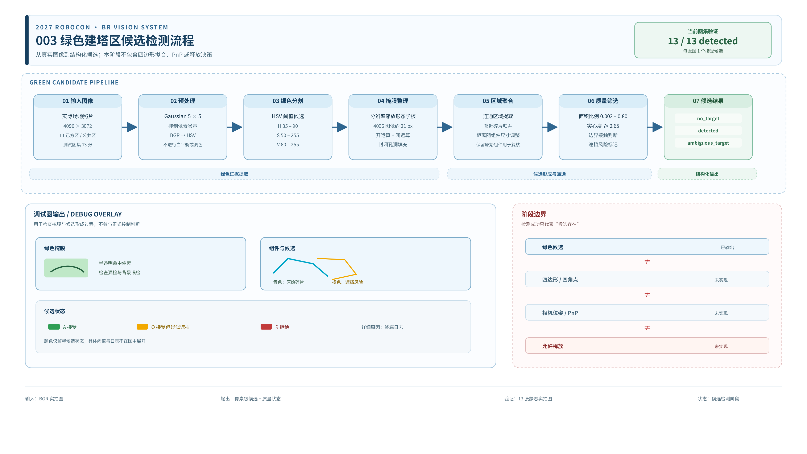

# 2026-10-26｜2027 ROBOCON BR 建塔感知：阶段 003 绿色建塔区候选检测

## 0. 一页摘要

| 项目 | 内容 |
| --- | --- |
| 今日问题 | 在反光、颜色不均和局部缺角条件下，能否稳定找到唯一的绿色建塔区候选？ |
| 今日结果 | 13 张实拍图全部得到 `detected`，每张只有一个接受候选 |
| 当前完成度 | 阶段 003 候选检测完成 |
| 证据范围 | 仅覆盖当前 13 张静态图片，不代表真实红底、实际 BR 相机或整机可靠性 |

今天的核心判断是：绿色颜色证据可以聚合成目标候选，但还不能直接当作完整
建塔区边界。候选检测成功不等于四角点、位姿或释放条件已经完成。

## 1. 起点与工作边界

001 完成了单图输入链路，002 解决了开发环境中的头文件索引问题。今天第一次
集中处理真实场地照片，工作重点从“程序能读图”推进到“图像中的绿色证据能否
形成可靠候选”。

任务层级需要严格区分：

```text
绿色像素
  ≠ 连通区域
  ≠ 建塔区候选
  ≠ 四条边与四角点
  ≠ 相机位姿
  ≠ 允许释放
```

阶段 003 只完成到建塔区候选检测。



## 2. 今日工作

今天建立并跑通了绿色建塔区候选检测流程：

1. 使用 13 张 4096×3072 的真实场地照片；
2. 覆盖 L1 己方区域和 L1 公共区域两种场景；
3. 从 HSV 颜色空间中提取绿色区域；
4. 清理小噪点、反光断缝和颜色不均造成的碎片；
5. 将属于同一目标的邻近绿色组件重新聚合；
6. 根据面积、实心度和边界状态筛选候选；
7. 为单目标、多目标和无目标情况保留不同状态；
8. 生成调试图检查绿色掩膜、原始碎片、候选轮廓和候选状态。

调试图状态现在使用单字母表示：

| 标记 | 含义 |
| --- | --- |
| `A` | 接受 |
| `O` | 接受，但疑似遮挡或边界不完整 |
| `R` | 拒绝 |

## 3. 关键观察

### 3.1 反光不是另一种颜色

原图看起来连续的绿色区域，在反光位置仍大致保持绿色，但饱和度会下降到
约 59～70。最初使用 `S >= 70` 时，这部分像素被排除，掩膜内部出现明显缺口。

将饱和度下限调整到 50 后，反光区域重新进入候选。灰白背景的饱和度更低，
仍能与目标区分。

调试图看起来像出现了两种完全不同的绿色，是因为命中的掩膜像素被叠加成了亮
绿色；输入原图没有做调色、白平衡或直方图增强。

### 3.2 连通碎片数量不等于目标数量

面板接缝、反光和颜色不均都可能把一个绿色目标切成多个连通区域。如果直接
按连通区域数量输出，就会出现“一个目标、多个候选”的错误。

今天的处理是优先把主目标附近和内部的小碎片重新聚合。`test12` 左右两段
绿色区域之间约有 119 像素间隙，最终合并为一个接受候选。

碎片聚合也有风险：两个距离很近的真实目标可能被错误连接。因此候选中仍保留
原始组件轮廓，用于检查合并是否合理。

### 3.3 缺角不能通过放宽颜色阈值解决

`test05`、`test11` 的问题是绿色区域本身缺一个角，而不是亮度不足。它们仍需
被识别为候选，并保留遮挡风险标记。

缺失角点应由后续四边形拟合阶段利用可见边线推断，不能为了得到完整形状而
随意降低颜色阈值。

## 4. 数据与结果

| 参数或处理 | 初始方案 | 当前方案 |
| --- | --- | --- |
| HSV 饱和度下限 | 70 | 50 |
| 形态学核 | 4096 图上等效 5 px | 按分辨率缩放为约 21 px |
| 实心度下限 | 0.90 | 0.65 |
| 反光孔洞 | 保留缺口 | 填充封闭孔洞 |
| 邻近碎片 | 容易形成多个候选 | 优先归并为一个目标 |

调整前：

```text
7 张 detected
6 张 no_target
失败主因均为 low_solidity
```

调整后：

```text
13 张 detected
每张 1 个接受候选
test05、test11 带遮挡风险标记
无 ambiguous_target
```

这说明当前候选检测图像集回归通过，但不能推导真实赛场和其他相机的成功率。

## 5. 今日形成的认识

1. 绿色目标的反光主要表现为饱和度下降和区域断裂，而不是颜色整体改变。
2. 处理颜色差异前应先判断来源：反光、接缝、边界还是真实目标差异。
3. 一个目标可以由多个绿色组件组成，检测结果应保留组件级证据。
4. 候选矩形只是调试范围，不能替代真实目标四角。
5. `detected` 表示找到候选，不表示已经测量位姿，更不表示可以释放。

## 6. 复习问题

1. 为什么一个绿色目标可能形成多个连通区域，却不能直接当成多个目标？
2. 为什么反光区域应优先通过饱和度调整和掩膜修复处理，而不是扩大全部 HSV 范围？
3. 为什么已经检测到绿色候选，仍不能说明已经获得建塔区位姿？

